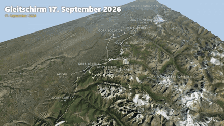
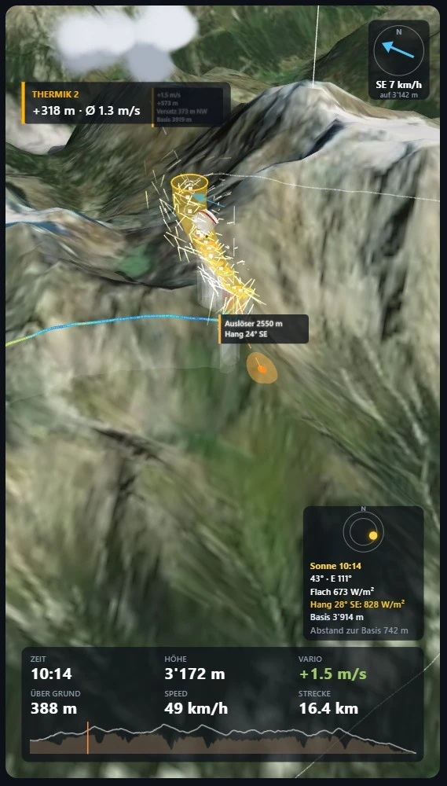
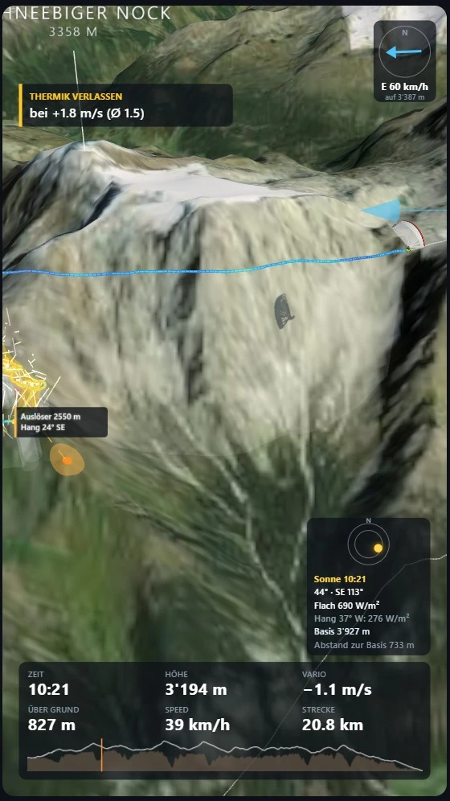
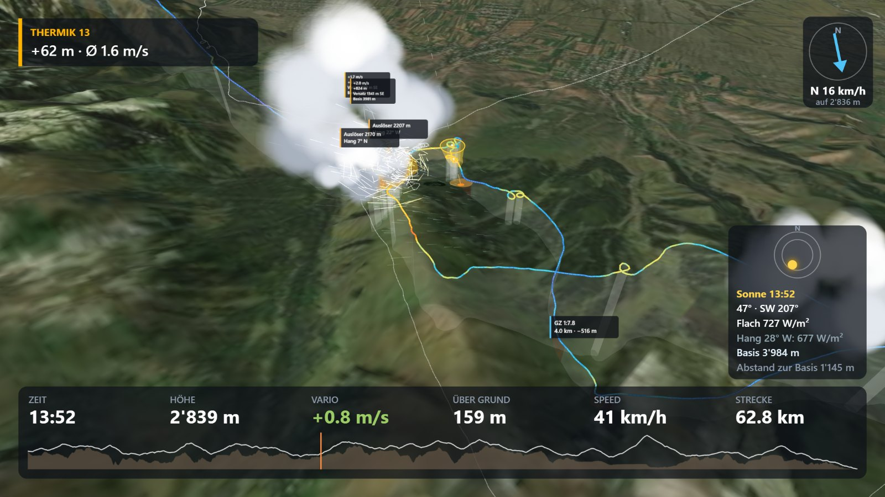
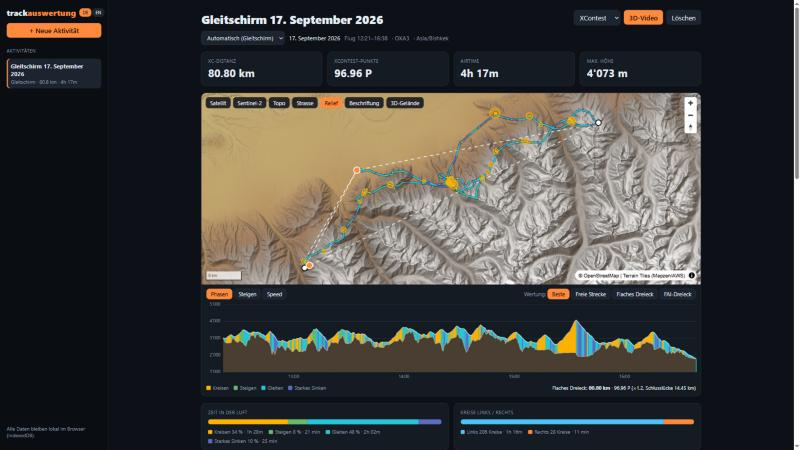
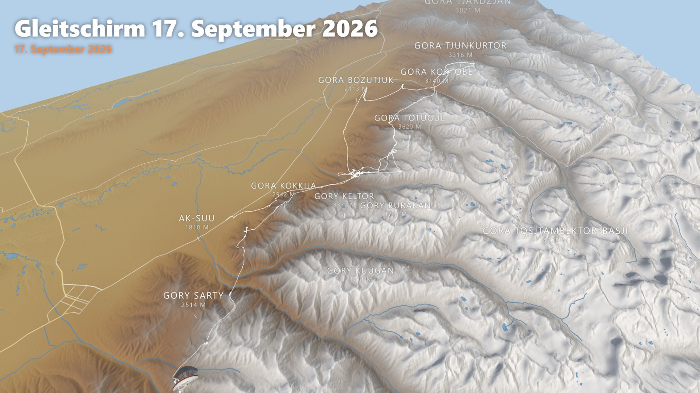

# Track-Auswertung

Eine Web-App, die Gleitschirmflüge auswertet und als 3D-Video ausgibt. Sie läuft im Browser und braucht
keine Anmeldung.

Du ziehst eine IGC-Datei vom Vario oder eine GPX-Datei von Uhr oder Handy hinein. Die App zeigt Karte,
Höhenprofil, XC-Wertung und jede Thermik und Gleitstrecke. Daraus kann sie ein MP4-Video im Hoch- oder
Querformat erzeugen. Gedacht ist sie für Gleitschirm, Hike & Fly und Drachen; Wanderungen gehen auch.

Online: https://tobmuc.github.io/track-auswertung/

Die Tracks bleiben im Browser gespeichert und werden nicht hochgeladen.

<p align="center">
  
</p>
<p align="center"><em>Ein 81-km-Streckenflug (4 h 17 min) als 30-Sekunden-Video, hier im Zeitraffer</em></p>

<p align="center">
  
  &nbsp;
  
</p>
<p align="center"><em>Hochformat 9:16 für Reels und Stories</em></p>


<p align="center"><em>Querformat 16:9 für YouTube</em></p>

## So geht's

1. Track laden: IGC oder GPX auf die Seite ziehen oder oben auf „Track laden“ klicken. Bei Hike & Fly
   den Aufstieg (GPX) und den Flug (IGC) zusammen auswählen.
2. Die Auswertung erscheint mit Karte, Kennzahlen, Flugbewertung, Höhenprofil, Thermiken und
   Gleitstrecken.
3. „3D-Video erstellen“ öffnet die Video-Ansicht. Dort wählst du Format, Länge, Karte, Schirm und Musik
   und siehst eine Vorschau.
4. „Video erstellen“ rendert das MP4 Bild für Bild im Browser. Danach lässt es sich speichern.

Der Video-Export braucht Chrome, Edge oder Safari ab Version 17.

## Auswertung



### Kennzahlen

XC-Distanz und Punkte nach XContest, FFVL, FAI oder XC League. Freie Strecke, flaches Dreieck und
FAI-Dreieck werden optimiert und auf der Karte eingezeichnet. Dazu kommen Airtime, Start- und Landezeit,
maximale Höhe, Überhöhung über dem Start, Tracklänge sowie mittlere und höchste Geschwindigkeit. Bei Hike &
Fly zählt die App auch Aufstieg, Gehzeit und Pausen.

### Flugbewertung

Eine kurze Zusammenfassung: was gut lief und wo vermutlich Zeit liegen geblieben ist. Jeder Punkt nennt
die Uhrzeit und die Messwerte, auf denen er beruht, und lässt sich anklicken, um die Stelle auf Karte und
Profil zu sehen. Erkannt werden derzeit:

- Kreisen im schwachen oberen Teil eines Barts, gemessen am Steigen der letzten Kreise
- langsames Zentrieren, wenn das Steigen erst nach mehreren Kreisen stand
- Thermiken, die deutlich unter dem Tagesschnitt lagen
- Gleitstrecken gegen den Wind oder im Sinken, die in Trimmfahrt geflogen wurden
- weite Kreise, die schlechter stiegen als enge
- auf der Habenseite der stärkste Bart, der beste Gleitflug, die schnellste halbe Stunde, schnelles
  Zentrieren und Fliegen nach Sollfahrt

Die Zeitangaben sind grobe Schätzungen. Gründe wie tiefe Lage, Luftraum oder eine geplante Route kann
die Auswertung nicht sehen.

### Thermik und Gleiten

Für jede Thermik zeigt die App Höhengewinn, mittleres Steigen, Basis und Top, Kreisrichtung und die
mittlere Zeit pro Kreis. Der Versatz des Thermikkerns vom untersten zum obersten Kreis zeigt, wie stark
der Wind den Bart verschoben hat. Wind wird auf zwei Wegen geschätzt: aus der Form der Kreise und aus der
Drift der Kreismittelpunkte. Gleitstrecken haben eine Gleitzahl über Grund und eine gegenüber der Luft.

### Kreisformen

Jeder Vollkreis wird einzeln vermessen: Durchmesser gegenüber der Luft, Kreiszeit, daraus berechnete
Querlage und Steigen. Diagramme zeigen die Verteilung der Steigwerte, Durchmesser gegen Steigen, Steigen
nach Höhe und nach Tageszeit sowie das Zentrieren Kreis für Kreis ab dem Einflug. Jedes Diagramm lässt
sich als PNG speichern.

### Fahrt durch die Luft

Aus der Geschwindigkeit über Grund und dem Wind aus den Kreisen ergibt sich die Fahrt gegenüber der Luft.
Die App schätzt daraus die Trimmfahrt, erkennt beschleunigte Phasen und vergleicht, wie oft bei Gegen-
und bei Rückenwind beschleunigt wurde.

### Karte und Höhenprofil

Kartengrundlagen sind Satellit, Sentinel-2, Topo, Strasse und eine Reliefkarte aus offenen Daten mit
Höhenfarben, Schummerung, Gewässern und Strassen. Beschriftungen und 3D-Gelände lassen sich zuschalten.
Die Spur ist nach Flugphase, Steigen oder Geschwindigkeit eingefärbt. Das Höhenprofil zeigt das Gelände
darunter; die Höhe über Grund kommt aus Terrain Tiles, OpenTopography oder eigenen DEM-Dateien.

## 3D-Video



### Bild und Kamera

Hochformat 9:16 oder Querformat 16:9, Full HD oder HD, 30 bis 180 Sekunden. Eine Verfolgerkamera folgt
dem Schirm auch im schnellen Zeitraffer, am Anfang steht ein Überflug, am Ende eine Übersicht. Start,
beste Thermiken, höchster Punkt und Landung können langsamer laufen. Karte, Überhöhung und
Kameradistanz sind einstellbar.

### Schirm und Piloten

Mehrere Schirmmodelle mit eigenen Farben. Der Schirm neigt sich in Kurven und nickt beim Einflug in eine
Thermik. Statt des Schirms kann ein Lichtpunkt mit Leuchtspur fliegen. Weitere Flüge vom selben Tag
lassen sich mit eigener Spurfarbe und eigenem Namen zuschalten; gleichzeitig geflogene Flüge laufen
synchron.

### Was im Bild erscheint

- Thermikschläuche mit Steigwert, entlang der Kreismittelpunkte versetzt
- der Thermik-Auslöser: die Achse der Thermik bis zum Boden verlängert, mit Höhe und Hangneigung
- Gleitzahl auf längeren Gleitstrecken
- eine Spur, die nach einstellbarer Zeit verblasst, während die Thermikkreise stehen bleiben
- Höhe über Grund als Vorhang unter der Spur, rot unter 150 m
- Windpfeil, Gipfel, Hütten und Orte
- Sonnenstand über die Flugzeit mit Schatten von Schirm und Bergen; Datum und Uhrzeit lassen sich
  verschieben
- Wolkenbasis aus Temperatur und Taupunkt des Flugtags (Open-Meteo, Faustformel 125 m × Spread) und
  Cumulus-Wolken über den Thermiken

### Ton

Die Musik wird im Browser erzeugt und ist frei von Rechten Dritter, in mehreren Stilen von Ambient bis
Drum & Bass. Eigene Musikdateien gehen auch. Vario-Töne folgen dem Steigen und Sinken.

## Datenschutz

Tracks, Auswertungen und Einstellungen liegen im Speicher deines Browsers (IndexedDB). Wenn du die
Browserdaten löschst, sind sie weg; die Originaldateien hast du weiterhin.

Aus dem Internet lädt die App Karten- und Höhenkacheln, Orte (Wikidata, OpenStreetMap), Gewässer und
Strassen für die Reliefkarte (OpenStreetMap) und Temperaturen für die Wolkenbasis (Open-Meteo). Übermittelt
wird dabei der Kartenausschnitt oder der Startort, nie der Track.

Die Online-Version nutzt Google Analytics nur, wenn du im Banner zustimmst. Ändern lässt sich das über
„Statistik-Einstellungen“ in der Fusszeile.

## Quellen

Gelände: Terrain Tiles (AWS). Karten: Esri, Sentinel-2 cloudless (EOX), OpenTopoMap, © OpenStreetMap.
Orte: Wikidata. Wetter: Open-Meteo. XC-Wertung: igc-xc-score.

Weitere Ideen und Prioritäten stehen in [docs/ROADMAP.md](docs/ROADMAP.md), die UI-Prüfung in
[docs/UI-UX-Review.md](docs/UI-UX-Review.md), die Gestaltungsregeln in [DESIGN.md](DESIGN.md).

## Für Entwickler

### Lokal starten

Unter Windows `start.bat` doppelklicken. Beim ersten Start werden die Abhängigkeiten installiert, danach
öffnet sich der Browser auf http://localhost:5173. Zum Beenden das Konsolenfenster schliessen.

Voraussetzung ist [Node.js](https://nodejs.org) (LTS). Von Hand:

```bash
npm install
npm run dev
```

| Befehl | Zweck |
|---|---|
| `npm test` | Tests |
| `npm run build` | Produktions-Build nach `dist/` |
| `npm run score -- <datei.igc>` | XC-Wertung einer Datei auf der Kommandozeile |

Gespeicherte Flüge gehören zur Adresse, unter der die App läuft: `localhost:5173` und die Online-Version
haben getrennte Speicher.

### Online-Version (GitHub Pages)

Die App liegt unter https://tobmuc.github.io/track-auswertung/ und wird aus dem Branch `gh-pages`
ausgeliefert, der den Inhalt von `dist/` enthält. Zum Veröffentlichen neu bauen und den Inhalt von
`dist/` mit einer leeren `.nojekyll` als neuen Commit auf `gh-pages` pushen.

Der Workflow `.github/workflows/pages.yml` würde das bei jedem Push erledigen. Er liegt bereit, ist aber
noch nicht im Repo, weil Workflow-Dateien die GitHub-Berechtigung `workflow` brauchen
(`gh auth refresh -h github.com -s workflow`). Danach die Datei committen und unter Settings, Pages die
Quelle auf „GitHub Actions“ stellen.

Die Fusszeile zeigt, welche Version online ist, zum Beispiel `v0.5.0, Build 20, 1a2b3c4, 05.11.2026`:
Version aus `package.json`, Anzahl Commits, Commit-Kürzel und Build-Datum. Ein `+` hinter dem Commit
bedeutet, dass mit nicht committeten Änderungen gebaut wurde. Ein Klick öffnet den Commit auf GitHub.

So testest du lokal wie auf Pages: `npm run build`, dann `npx vite preview --base /track-auswertung/`.

Google Analytics (GA4, Mess-ID in `.env.production`) ist nur im gebauten Online-Stand aktiv und lädt erst
nach Zustimmung im Banner. Ohne `VITE_GA_ID` wird ohne Analytics gebaut.
